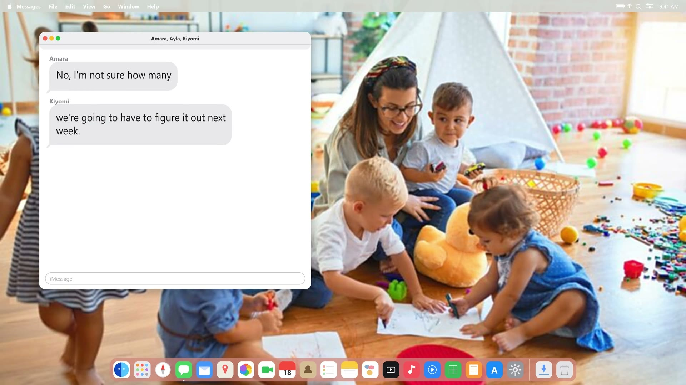
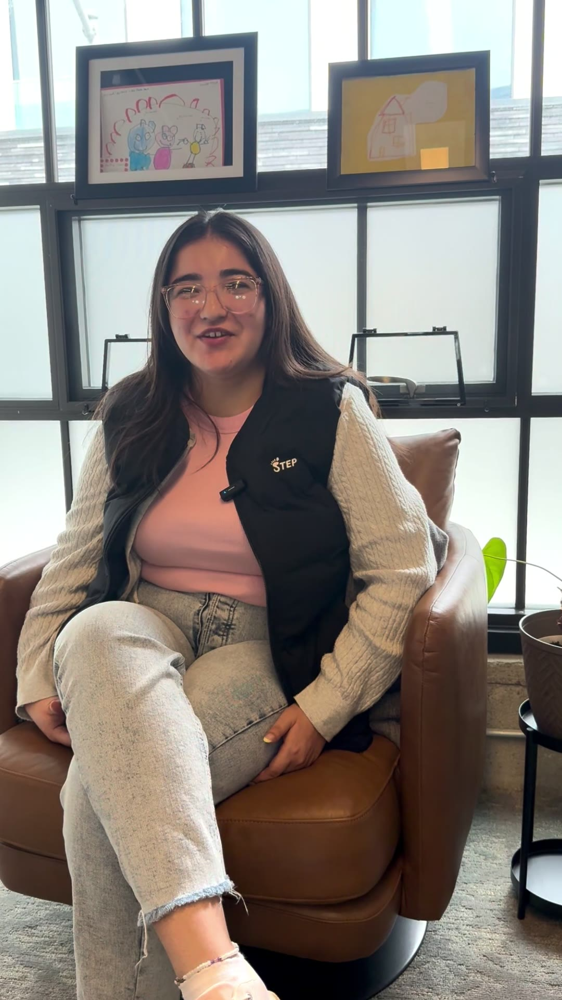
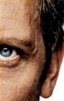
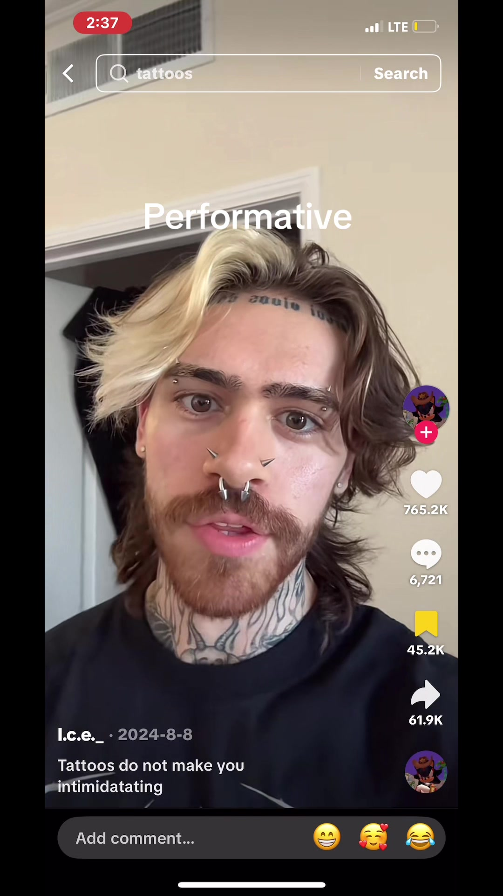
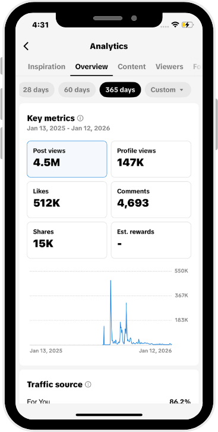

```{=html}

<div class="social-stage">
<div class="social-canvas">

<h1 class="soc-title">Content Creation</h1>

<!-- ---------------- for brands ---------------- -->
<h2 class="soc-label soc-label-brands">for brands:</h2>
<p class="soc-note soc-note-espanol">en espa&ntilde;ol</p>

<figure class="soc-item soc-b1">
  <div class="soc-frame">
    <button class="soc-play" type="button"
            data-kind="inline" data-src="assets/1.mp4" data-aspect="portrait"
            aria-label="Play STEP brand video 1">
      
    </button>
  </div>
  <figcaption></figcaption>
</figure>

<figure class="soc-item soc-b2">
  <div class="soc-frame">
    <button class="soc-play" type="button"
            data-kind="inline" data-src="assets/2.mp4" data-aspect="landscape"
            aria-label="Play STEP brand video 2">
      
    </button>
  </div>
  <figcaption></figcaption>
</figure>

<figure class="soc-item soc-b3">
  <div class="soc-frame">
    <button class="soc-play" type="button"
            data-kind="inline" data-src="assets/3.mp4" data-aspect="portrait"
            aria-label="Play STEP brand video 3, en espanol">
      
    </button>
  </div>
  <figcaption></figcaption>
</figure>

<figure class="soc-item soc-b4">
  <div class="soc-frame">
    <button class="soc-play" type="button"
            data-kind="inline" data-src="assets/4.mp4" data-aspect="portrait"
            aria-label="Play STEP brand video 4, en espanol">
      
    </button>
  </div>
  <figcaption></figcaption>
</figure>

<span class="soc-arrow" aria-hidden="true"></span>

<!-- ---------------- personal ---------------- -->
<h2 class="soc-label soc-label-personal">personal:</h2>

<figure class="soc-item soc-p1">
  <div class="soc-frame">
    <button class="soc-play" type="button"
            data-kind="embed" data-src="https://www.tiktok.com/embed/v2/7550872873171193102" data-aspect="portrait"
            aria-label="Play TikTok video, 800K views">
      
    </button>
  </div>
  <figcaption>800K views</figcaption>
</figure>

<figure class="soc-item soc-p2">
  <div class="soc-frame">
    <button class="soc-play" type="button"
            data-kind="embed" data-src="https://www.tiktok.com/embed/v2/7529656863948836126" data-aspect="portrait"
            aria-label="Play TikTok video, 4.3M views">
      
    </button>
  </div>
  <figcaption>4.3M views</figcaption>
</figure>

<figure class="soc-item soc-p3">
  <div class="soc-frame">
    <button class="soc-play" type="button"
            data-kind="embed" data-src="https://www.youtube.com/embed/7u2vRZPTEVk?autoplay=1" data-aspect="landscape"
            aria-label="Play YouTube video, 9.2k views">
      
    </button>
  </div>
  <figcaption>9.2k views</figcaption>
</figure>

<a class="soc-logo soc-logo-tiktok" href="https://www.tiktok.com/@airpodsfannirvaan"
   target="_blank" rel="noopener" aria-label="TikTok profile"></a>
<a class="soc-logo soc-logo-youtube" href="https://www.youtube.com/@nirvracker"
   target="_blank" rel="noopener" aria-label="YouTube channel"></a>

<!-- ---------------- background ---------------- -->
<h2 class="soc-label soc-label-background">background:</h2>

<div class="soc-copy">
<p>Over the summer of 2025, I was determined to learn about social media and
begin creating my own content. I created a personal TikTok account on July 20
and, within less than 3 months, managed to grow more than <strong>4500</strong>
followers and <mark>more than <strong>4 million</strong> total views</mark></p>

<p>Although the account only represents me, featuring mostly storytelling and
comedy videos, I learned countless skills, such as social media metrics,
analytics, key steps towards virality, and so much more!</p>

<p>Since then, I have begun to make content on behalf of brands as well. In
2026, I made several videos during an internship for STEP (Substitute Teacher
Empowerment &amp; Placement [an SF-based non-profit]) featured above.</p>
</div>



</div>
</div>
<div class="soc-lightbox" id="soc-lightbox" role="dialog" aria-modal="true" aria-label="Video player" hidden>
  <div class="soc-lb-media" id="soc-lb-media">
    <button class="soc-lb-close" id="soc-lb-close" type="button" aria-label="Close video"></button>
  </div>
</div>
<script src="js/social.js"></script>
```
